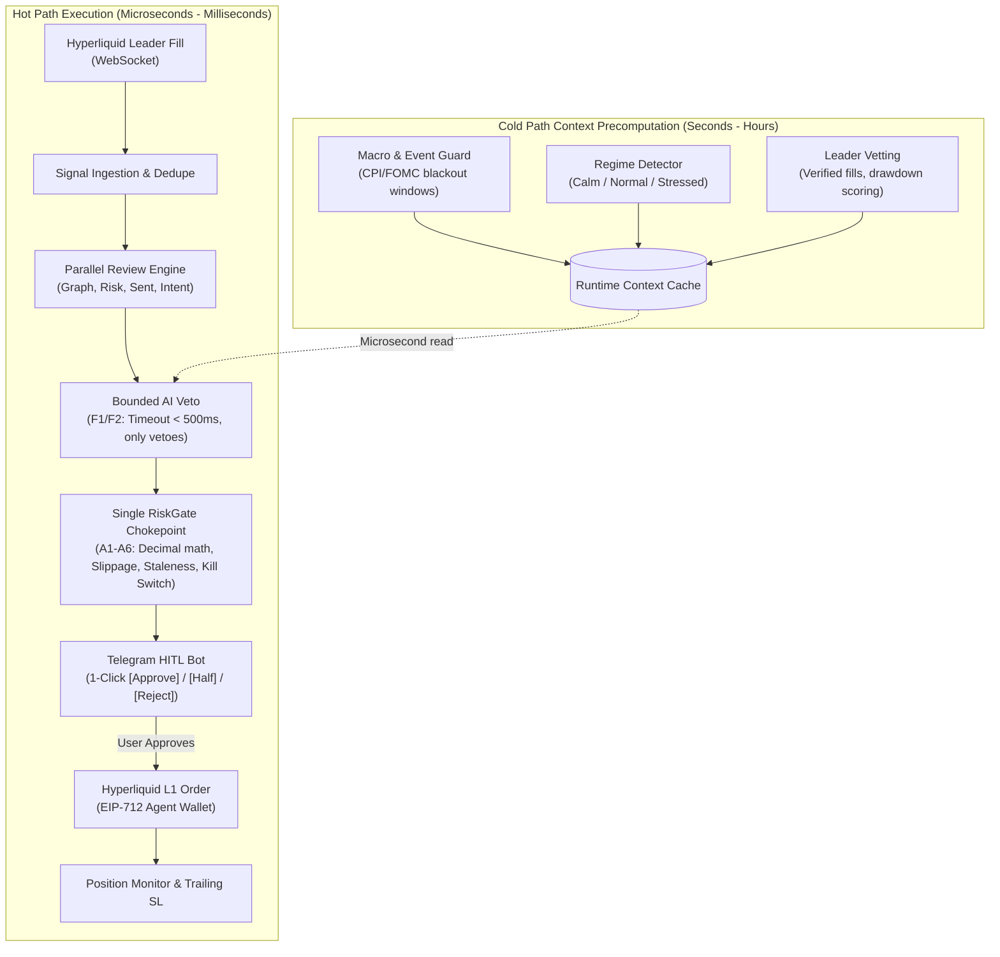

# Hyperliquid AI Copy-Trading & Multi-Agent SDLC System

An institutional-grade, multi-agent AI copy-trading platform for **Hyperliquid Perps**, governed by a dual-lifecycle architecture:
1. **Live Trade Operational Pipeline**: Signal Ingestion $\to$ Cold-Path Context Cache $\to$ 4-Agent Parallel Review $\to$ Bounded AI Veto $\to$ Single RiskGate Chokepoint $\to$ Human-in-the-Loop Telegram 1-Click Approval $\to$ Hyperliquid L1 Order Execution $\to$ Active Trailing Position Management.
2. **Multi-Agent SDLC Strategy Lifecycle**: 21 specialized agents with hard gates (`/brainstorm` $\to$ `/discovery` $\to$ `/research` $\to$ `/pm` $\to$ `/tests` $\to$ `/build` $\to$ `/review` $\to$ `/qa` $\to$ `/verify` $\to$ `/ship` $\to$ `/go-live`), automated backtesting, post-mortem feedback loops, and dynamic prompt/risk parameter tuning.

---

## 🏛️ System Architecture



---

## 🛑 Non-Negotiable Trading Invariants (A1–F3)

Every feature, review agent, and execution path must pass the institutional money-safety invariants:

| Category | Invariant | Description |
| :--- | :--- | :--- |
| **Execution Safety** | **A1** | **Single chokepoint.** Every order goes through `RiskGate`. No code path reaches exchange execution directly. |
| | **A2** | **Fail closed.** Missing config, stale data, or an exception inside the gate strictly blocks the order. |
| | **A3** | **Hard limits are config, not code.** Max position size, max leverage, and max daily loss are externalized. |
| | **A4** | **Kill switch.** Persistent CLI and Telegram `/kill` halts all trading immediately across restarts. |
| | **A5** | **Idempotency.** Orders carry deterministic client IDs derived from the signal to prevent double execution. |
| | **A6** | **Money is Decimal.** All prices, quantities, and notional math use `Decimal`. Floats strictly forbidden. |
| **Data & Timing** | **B1** | **Staleness guard.** Signals older than configured TTL (default 45s) are rejected immediately. |
| | **B5** | **Audit logging.** Every decision is logged append-only with input context, risk checks, and latency. |
| **Copy Trading** | **C1** | Leaders are scored on **verified fills** on-chain, never self-reported ROI. |
| | **C2** | Size by **our** risk budget, never by the leader's account size. |
| | **C3** | **Slippage guard.** Skip copy if the market price has moved beyond tolerance from the master's fill price. |
| **AI Governance** | **F1–F3** | **LLMs off the hot path.** Inline AI checks have strict timeouts ($< 500\text{ ms}$) and can **only veto**, never raise size. |

---

## 🤖 The 21 SDLC Agents (Build & Review System)

Governed by `docs/protocol.md`, `CLAUDE.md`, and `AGENTS.md`:

```
.claude/agents/  &  .agents/rules/
├── architect.md             # High-level architecture, subsystem boundaries
├── senior-dev.md            # Senior code review, idiomatic patterns
├── developer.md             # TDD implementation (tests fail before they pass)
├── test-designer.md         # Acceptance Criteria -> Test coverage matrix
├── test-reviewer.md         # Asserts tests don't mock our own code or test tautologies
├── qa.md                    # Smoke, edge cases, integration
├── qa-simulation.md         # Replay simulation with simulated network latency & slippage
├── backtest-auditor.md      # Lookahead bias, survivorship bias, fee realism checks
├── quant-researcher.md      # Statistical significance, edge hypothesis validation
├── market-analyst.md        # Market regime, macro environment briefings
├── discovery.md             # Clarifying questions before any code is written
├── pm.md                    # Feature specs, acceptance criteria, config tables
└── Specialized Review Panel:
    ├── reviewer-risk.md         # Sizing, leverage, liquidation buffer, fail-closed
    ├── reviewer-security.md     # Secrets isolation, authentication, non-root execution
    ├── reviewer-latency.md      # Microsecond hot-path performance, non-blocking I/O
    ├── reviewer-exchange.md     # Hyperliquid tick/step size, EIP-712 signing, funding rates
    ├── reviewer-compliance.md   # Trading invariants (A1-F3) verification
    ├── reviewer-dry.md          # Duplication & dead-code elimination
    ├── reviewer-changes.md      # Scope creep & unexpected diff inspection
    └── reviewer-general.md      # General code hygiene & documentation
```

---

## 📁 Project Structure

```
hyperliquid-ai-copysdlc/
├── .agents/                 # Antigravity IDE workspace customization
│   └── rules/               # Native Antigravity rules (trading invariants & protocol)
├── .claude/                 # Claude Code multi-agent system
│   ├── agents/              # 21 specialized build & review agent specifications
│   ├── commands/            # Slash commands (/brainstorm, /pm, /tests, /review, etc.)
│   ├── knowledge/           # Invariants and protocol specs
│   └── settings.json        # Security permissions (prevents reading .env or force pushing)
├── docs/
│   ├── RUNTIME-AGENTS.md    # Architecture: Cold-path precomputation vs hot-path execution
│   └── SETUP.md             # Deployment and setup guide
├── src/
│   ├── agents/
│   │   ├── base_agent.py          # Abstract base reviewer
│   │   ├── graph_agent.py         # Technical analysis (S/R, RSI, Trend)
│   │   ├── risk_guard_agent.py    # Sizing and risk bounds
│   │   ├── sentiment_agent.py     # Sentiment and funding rate analysis
│   │   ├── trader_intent_agent.py # Intent classifier (Hedge vs FOMO vs Swing)
│   │   ├── runtime_guards.py      # Cold-path context cache & Bounded AI Veto (F1-F3)
│   │   └── consensus_engine.py    # Parallel aggregator & card generator
│   ├── execution/
│   │   ├── risk_gate.py           # Single RiskGate chokepoint (A1-A6, Decimal math)
│   │   ├── kill_switch.py         # Persistent Kill Switch (A4)
│   │   ├── hyperliquid_trader.py  # Hyperliquid L1 order execution & simulation
│   │   └── position_monitor.py    # Trailing stops & position tracker
│   ├── hitl/
│   │   ├── approval_queue.py      # TTL-governed signal queue
│   │   └── telegram_bot.py        # aiogram 3 bot with interactive inline buttons
│   ├── ingestion/
│   │   ├── hyperliquid_rest.py    # REST client (clearinghouse, candles, funding)
│   │   └── hyperliquid_ws.py      # WebSocket client for user fills
│   ├── sdlc/
│   │   ├── backtester.py          # Historical simulation & metric calculations
│   │   ├── prompt_registry.py     # Versioned agent system prompts
│   │   └── strategy_evaluator.py  # Trade post-mortem & heuristic tuning
│   ├── config.py            # Pydantic settings & validation
│   ├── models.py            # Domain models & type definitions
│   └── main.py              # Main orchestrator & entrypoint
├── tests/
│   ├── test_agents.py       # Agent unit tests
│   ├── test_invariants.py   # Explicit unit tests for Invariants A1, A2, A4, A6, B1, C3, F1-F2
│   └── test_sdlc.py         # SDLC and backtest tests
├── AGENTS.md                # Antigravity IDE configuration & non-negotiables
├── CLAUDE.md                # Claude Code CTO orchestrator configuration
├── .env.example             # Environment variable template
├── requirements.txt         # Project dependencies
└── README.md                # System documentation
```

---

## ⚡ Quick Start

### 1. Set Active Workspace
Set your workspace folder in your IDE to:
`C:\Users\arthu\.gemini\antigravity-ide\scratch\hyperliquid-ai-copysdlc`

### 2. Install Dependencies
```bash
pip install -r requirements.txt
```

### 3. Run the Demo Simulation
Run an end-to-end simulation of an incoming master whale signal through the multi-agent review pipeline, bounded AI Veto, single RiskGate chokepoint, and execution:
```bash
python src/main.py --demo
```

### 4. Run the Test Suite (11/11 Invariant & Agent Tests)
```bash
pytest -v
```

### 5. Emergency Kill Switch Command
To immediately halt all trading and fail closed across restarts:
```python
from src.execution.kill_switch import kill_switch
kill_switch.activate("Emergency manual stop")
```
Or send `/kill` in your authorized Telegram chat.
